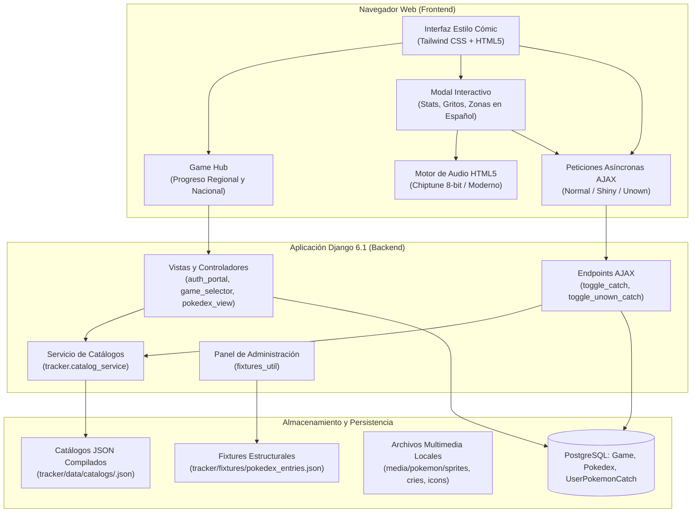

# 🔴 Pokédex Global Tracker ⚪ (Español)

[](https://www.djangoproject.com/)
[](https://www.python.org/)
[](https://www.postgresql.org/)
[](https://tailwindcss.com/)
[](https://opensource.org/licenses/MIT)

> **Idiomas disponibles:**  
> 🇬🇧 [English Version (Primary README)](README.md)  
> 🇪🇸 **Español (Este documento)**

---

## 📖 Descripción General

**Pokédex Global Tracker** es una plataforma web completa desarrollada con **Django 6.1.1** y **PostgreSQL**, diseñada para coleccionistas, entrenadores y entusiastas que desean registrar y monitorear su progreso de captura de Pokémon a través de todas las generaciones de videojuegos (desde la 1ª Generación en Kanto hasta la 9ª Generación en Paldea).

El proyecto opera bajo una **Arquitectura de Catálogos Precompilados en Memoria (0 ms SQL)** que sirve las especies con latencia cero, reservando la base de datos relacional PostgreSQL de forma exclusiva para el seguimiento de capturas del usuario y metadatos de juegos.

---

### 🌟 Características Principales

- **Catálogos Inmutables en Memoria (0 ms SQL)**: Las listas de la Pokédex, estadísticas, sprites y encuentros se cargan instantáneamente desde archivos JSON estáticos (`tracker/data/catalogs/`) gestionados por `catalog_service.py`.
- **Game Hub Interactivo (`/games/`)**: Selector visual de ediciones organizado por generaciones, con barras de progreso retro duales (progreso regional y nacional) y métricas de completitud.
- **Fidelidad Canónica e Histórica**: Tipos elementales exactos según la generación seleccionada (ej: Magnemite es Eléctrico puro en Gen 1 y Eléctrico/Acero en Gen 2+; Clefairy es Normal en Gen 1-5 y Hada en Gen 6+).
- **Inmersión Sonora Retro y Moderna**: Reproducción de gritos vintage chiptune en 8 bits para títulos de Generaciones 1 a 5 y gritos actualizados en alta fidelidad para títulos en 3D (Gen 6+).
- **Seguimiento Dual (Normal y Variocolor / Shiny)**: Conmutador en vivo para alternar la vista entre capturas regulares y variantes shinies, con paletas doradas y porcentajes independientes.
- **Álbum de Ruinas Unown**: Modal dedicado para registrar individualmente las 26 a 28 formas alfabéticas de Unown tanto en su variante normal como variocolor.
- **Filtros Avanzados Reactivos**: Búsqueda instantánea en el cliente por nombre en español/inglés, número, tipos elementales, cañas de pescar (Vieja, Buena, Súper) y etiquetas especiales (Iniciales, Fósiles, Legendarios, Bebés, Exclusivos).
- **Identidad Flexible de Usuario**: Soporte completo tanto para usuarios autenticados como para invitados anónimos (mediante cookies de sesión Django), sin forzar un registro previo.

---

## 🏗️ Arquitectura del Sistema



---

## 🚀 Requisitos Previos e Instalación

### Requisitos del Sistema:
- **Python 3.12+**
- **PostgreSQL 16+**
- **Git**

### 1. Clonar el Repositorio y Configurar Entorno Virtual
```bash
git clone https://github.com/Jorge/PokedexGlobal.git
cd PokedexGlobal/pokedexglobal

# Crear y activar entorno virtual
python -m venv .venv
# En Windows (PowerShell):
.venv\Scripts\Activate.ps1
# En Linux/macOS:
source .venv/bin/activate
```

### 2. Instalar Dependencias
```bash
pip install -r requirements.txt
```

### 3. Configurar Variables de Entorno (`.env`)
Crea un archivo `.env` en la raíz del proyecto basándote en la configuración de PostgreSQL local:
```env
DEBUG=True
SECRET_KEY=clave_secreta_de_desarrollo_insegura
DB_NAME=pokedex_db
DB_USER=postgres
DB_PASSWORD=tu_contraseña
DB_HOST=127.0.0.1
DB_PORT=5432
```

### 4. Ejecutar Migraciones y Cargar Metadatos de Juegos
```bash
# Aplicar migraciones estructurales
python manage.py migrate

# Cargar catálogo de ediciones y Pokédex desde fixture
python manage.py loaddata tracker/fixtures/pokedex_entries.json
```

---

## 💻 Ejecución del Servidor

Inicia el servidor de desarrollo integrado de Django:
```bash
python manage.py runserver 127.0.0.1:8000
```

Accede desde tu navegador web:
- **Portal de Acceso / Inicio**: [http://127.0.0.1:8000/](http://127.0.0.1:8000/)
- **Game Hub (Selector de Juegos)**: [http://127.0.0.1:8000/games/](http://127.0.0.1:8000/games/)
- **Pokédex Regional de Kanto (Rojo)**: [http://127.0.0.1:8000/red/](http://127.0.0.1:8000/red/)
- **Panel Administrativo**: [http://127.0.0.1:8000/admin/](http://127.0.0.1:8000/admin/)

---

## 🧪 Ejecución de Pruebas Automatizadas

El proyecto cuenta con **173 pruebas unitarias y de integración** organizadas modularmente en `tracker/tests/`. Se ejecutan reutilizando la base de datos de pruebas mediante `--keepdb`:

```bash
# Ejecución focalizada por módulo:
python manage.py test tracker.tests.test_auth --keepdb      # Autenticación y sesiones (29 tests)
python manage.py test tracker.tests.test_views --keepdb     # Vistas, Game Hub e interactividad (34 tests)
python manage.py test tracker.tests.test_catalogs --keepdb  # Catálogos y canon (65 tests)
python manage.py test tracker.tests.test_fixtures --keepdb  # Fixtures y mecánicas de Gen 2 (45 tests)

# Ejecución de la suite completa:
python manage.py test --keepdb
```

---

## 📚 Documentación Técnica Detallada

Para profundizar en cada subsistema, consulta los manuales especializados de la carpeta `docs/es/`:

- [Índice General de Documentación](docs/es/README.md)
  - [🏛️ Arquitectura y Diseño del Sistema](docs/es/arquitectura.md)
  - [🗄️ Modelos de Base de Datos y Catálogos](docs/es/modelos-de-datos.md)
  - [⚙️ Comandos de Gestión y Scripts](docs/es/comandos-de-gestion.md)
  - [🌐 Endpoints de API y Rutas](docs/es/api-y-endpoints.md)
  - [🎨 Interfaz Estilo Cómic y Componentes](docs/es/interfaz-y-componentes.md)
  - [🛡️ Panel de Administración y Fixtures](docs/es/administracion-y-fixtures.md)
  - [🧪 Guía de Pruebas Automatizadas](docs/es/guia-de-pruebas.md)
- [📖 Guía de Integración de Nuevos Juegos](guides/especificacion-nuevo-juego.md)
