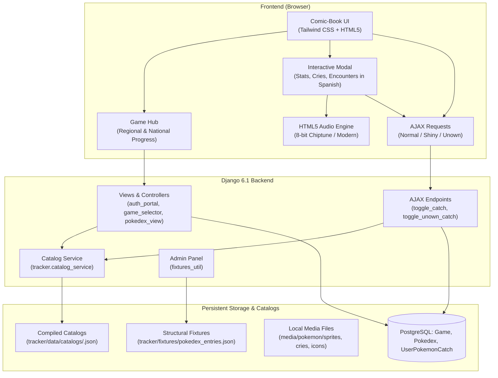

# 🔴 Pokédex Global Tracker ⚪

[](https://www.djangoproject.com/)
[](https://www.python.org/)
[](https://www.postgresql.org/)
[](https://tailwindcss.com/)
[](https://opensource.org/licenses/MIT)

> **Languages / Idiomas:**  
> 🇬🇧 **[English Documentation](#english-version)** (This Document)  
> 🇪🇸 **[Documentación en Español](README.es.md)** (Archivo Dedicado)

---

<a name="english-version"></a>
# 🇬🇧 English Version

## 📖 Overview

**Pokédex Global Tracker** is a full-featured web application built with **Django 6.1.1** and **PostgreSQL** designed to track Pokémon catching progress across multiple video game generations (from Generation I in Kanto up to Generation IX in Paldea).

The application operates under an **In-Memory Precompiled Catalogs Architecture (0 ms SQL)** that delivers Pokédex entries with zero query latency, dedicating the PostgreSQL relational database solely to user catch tracking and edition metadata.

---

### 🌟 Key Features

- **Immutable In-Memory Catalogs (0 ms SQL)**: Pokédex listings, moves, stats, official Spanish locations, and sprites are served in memory via `catalog_service.py` from static compiled JSON files (`tracker/data/catalogs/`).
- **Interactive Game Hub (`/games/`)**: Central edition selector organized by canonical generations, featuring dual retro progress meters (regional and national completion) and live statistics.
- **Generation-Accurate Data**: Canonical typings respecting each edition's historical rules (e.g. Magnemite is pure Electric in Gen 1 and Electric/Steel in Gen 2+; Clefairy is Normal in Gen 1-5 and Fairy in Gen 6+).
- **Retro & Modern Soundscape**: Dynamic cry playback: 8-bit vintage chiptune cries for retro generations (Gen 1 to 5) and orchestrated high-fidelity cries for 3D generations (Gen 6+).
- **Dual Mode Catch Tracking (Normal vs Shiny)**: Live navbar toggle to switch the grid between regular and shiny variant modes, featuring star effects, alternate sprites, and independent completion percentages.
- **Ruins of Alph Unown Album**: Dedicated modal to track all 26 alphabetical forms (A-Z) and punctuation marks (? and !), for both standard and shiny catches.
- **Comic-Book UI Design**: Hard ink drop shadows, Ben-Day dot patterns, dialogue bubble descriptions, and responsive mobile-first layouts.
- **Reactive Client Filtering**: Real-time filtering by number, localized name, elemental types, fishing rods (Old, Good, Super), and special categories (Starters, Fossils, Legendaries, Babies, Exclusives).
- **Flexible Identity Management**: Seamless catch tracking for both authenticated users and anonymous guest visitors via Django session cookies.

---

## 🏗️ Architecture Overview



---

## 🚀 Getting Started & Installation

### Prerequisites:
- **Python 3.12+**
- **PostgreSQL 16+**
- **Git**

### 1. Clone Repository & Setup Virtual Environment
```bash
git clone https://github.com/Jorge/PokedexGlobal.git
cd PokedexGlobal/pokedexglobal

# Create and activate virtual environment
python -m venv .venv
# On Windows (PowerShell):
.venv\Scripts\Activate.ps1
# On Linux/macOS:
source .venv/bin/activate
```

### 2. Install Dependencies
```bash
pip install -r requirements.txt
```

### 3. Environment Variables Configuration (`.env`)
Create a `.env` file in the root directory:
```env
DEBUG=True
SECRET_KEY=your_insecure_development_secret_key
DB_NAME=pokedex_db
DB_USER=postgres
DB_PASSWORD=your_password
DB_HOST=127.0.0.1
DB_PORT=5432
```

### 4. Run Migrations & Load Edition Metadata
```bash
# Run database schema migrations
python manage.py migrate

# Seed game editions and Pokédex sections from fixture
python manage.py loaddata tracker/fixtures/pokedex_entries.json
```

---

## 💻 Running the Server

Start Django's development server:
```bash
python manage.py runserver 127.0.0.1:8000
```

Access in your browser:
- **Auth Portal / Landing**: [http://127.0.0.1:8000/](http://127.0.0.1:8000/)
- **Game Hub (Edition Selector)**: [http://127.0.0.1:8000/games/](http://127.0.0.1:8000/games/)
- **Kanto Regional Pokédex (Red)**: [http://127.0.0.1:8000/red/](http://127.0.0.1:8000/red/)
- **Admin Dashboard**: [http://127.0.0.1:8000/admin/](http://127.0.0.1:8000/admin/)

---

## 🧪 Running Automated Tests

The test suite includes **173 unit and integration tests** organized across four modules in `tracker/tests/`. Run them reusing the test database via `--keepdb`:

```bash
# Targeted modular execution:
python manage.py test tracker.tests.test_auth --keepdb      # Auth and sessions (29 tests)
python manage.py test tracker.tests.test_views --keepdb     # Views, Game Hub & interactivity (34 tests)
python manage.py test tracker.tests.test_catalogs --keepdb  # Catalogs and canon (65 tests)
python manage.py test tracker.tests.test_fixtures --keepdb  # Fixtures and Gen 2 mechanics (45 tests)

# Full test suite:
python manage.py test --keepdb
```

---

## 📚 In-Depth Technical Documentation

For detailed architectural and subsystem specifications, explore the `docs/en/` directory:

- [English Documentation Index](docs/en/README.md)
  - [🏛️ System Architecture & Design](docs/en/architecture.md)
  - [🗄️ Database Models & Catalogs](docs/en/database-models.md)
  - [⚙️ Management Commands & Scripts](docs/en/management-commands.md)
  - [🌐 API Endpoints & Routes](docs/en/api-and-endpoints.md)
  - [🎨 Comic-Book UI & Components](docs/en/ui-and-components.md)
  - [🛡️ Admin Panel & Fixtures](docs/en/admin-and-fixtures.md)
  - [🧪 Testing & QA Guide](docs/en/testing-guide.md)
- [📖 Integration Guide for New Games (Spanish)](guides/especificacion-nuevo-juego.md)
