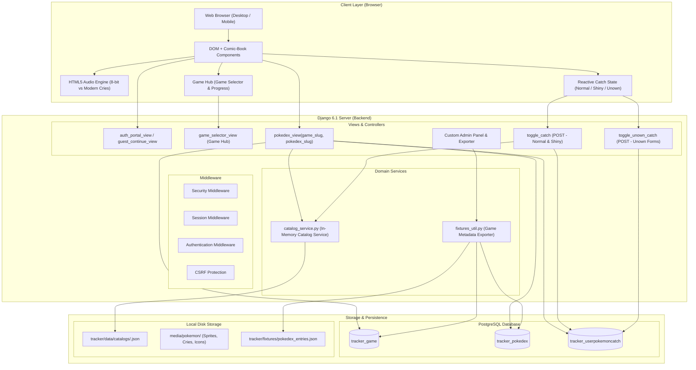
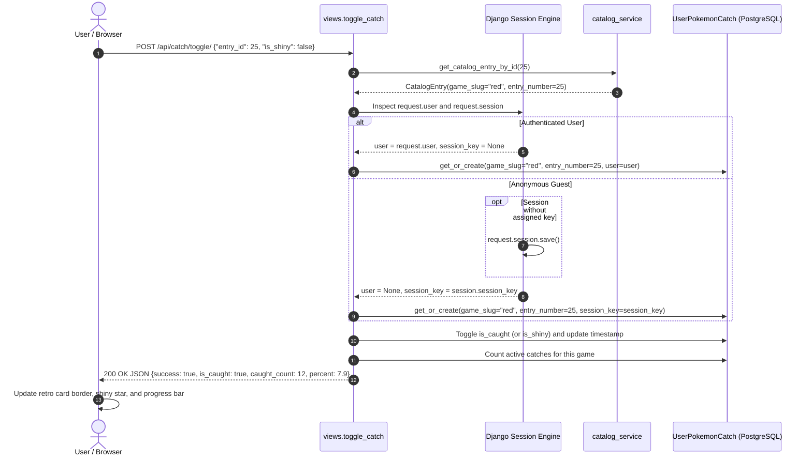

# 🏛️ Architecture and System Design (English)

## 1. System Overview

**Pokédex Global Tracker** is engineered as a high-performance Django web platform tailored for multi-generational Pokémon tracking and historical canon preservation.

The system is built upon a strategic decoupling between **canonical static data** and **dynamic user progress**:
1. **In-Memory Immutable Catalogs (0 ms SQL)**: Pokémon species, regional numbering, stats, historical typings, official encounter methods in Spanish, and sprite paths are not queried from heavy database tables on every request. Instead, they are loaded into memory from precompiled JSON files managed by `catalog_service.py`.
2. **Lightweight Relational Persistence**: PostgreSQL exclusively stores game structural entities (`Game`, `Pokedex`) and user catch records (`UserPokemonCatch`), supporting both anonymous guest sessions and authenticated user accounts.
3. **Retro-Interactive User Experience**: Comic-book aesthetic (Ben-Day dots, hard ink drop shadows), dynamic chiptune/orchestrated cries, generational Game Hub, shiny variant tracking, and Unown glyph albums.

---

## 2. System Architecture Diagram

---

## 3. System Evolution: In-Memory Precompiled Catalogs Architecture (0 ms SQL)

> [!NOTE]
> **Design Rationale:** In early versions, species and pokedex entries were stored as traditional Django ORM tables (`Pokemon`, `PokedexEntry`, `Move`). This resulted in thousands of static database rows, complex $N+1$ queries for grid rendering, and recurring database migration overhead when introducing new games.

To eliminate this bottleneck and provide an instant, zero-latency *Offline-First* experience:
1. **Precompiled Immutable Catalogs**: Canonical game data is compiled into static JSON files under `tracker/data/catalogs/<game_slug>.json`.
2. **In-Memory `CatalogService`**: When handling requests, `tracker.catalog_service` deserializes and caches catalog entries (`_CATALOG_CACHE`), validating file `mtime` for hot-reloads during development.
3. **Dedicated Relational Tracking**: PostgreSQL resources are dedicated to indexing user progress (`UserPokemonCatch`) with optimized composite indices.

---

## 4. Catch Lifecycle and Tracking Mechanics

### 4.1 Dual User Identity (Guest vs Authenticated)
The platform allows immediate catching without forced registration by utilizing Django anonymous sessions:

### 4.2 Dual Mode Tracking (Normal vs Shiny)
* The `/api/catch/toggle/` endpoint accepts the boolean flag `is_shiny`.
* The database stores `is_caught` and `is_shiny` independently on the same `UserPokemonCatch` record identified by `(game_slug, entry_number)`.
* This allows live switching between normal and shiny modes without page reloads.

### 4.3 Unown Glyph Tracking
* For titles with ruins (Gen 2 Gold/Silver/Crystal, Gen 3 FireRed/LeafGreen), `/api/unown-catch/toggle/` updates the native `JSONField(unown_forms_caught)`.
* Payload structure: `{"normal": ["A", "F", "R"], "shiny": ["A"]}`.
* Catching at least one glyph registers Unown as caught in the overall Pokédex while preserving individual letter tracking in the dedicated album modal.

---

## 5. Performance Optimizations

1. **$O(1)$ Catalog Access**: Instant in-memory retrieval without database locks or transaction overhead.
2. **In-Memory Set Lookup**: In `pokedex_view`, user catches for the active game are fetched in a single indexed query (`values_list('entry_number', flat=True)`) and evaluated in constant time $O(1)$.
3. **Composite Database Indices**:
   * `[user, game_slug]`
   * `[session_key, game_slug]`
   * `[game_slug, entry_number]`
4. **Reactive Cache Invalidation**: Django signals (`post_save`, `post_delete`) on `Game` invalidate the `all_games_catalog` cache key upon admin edits.
