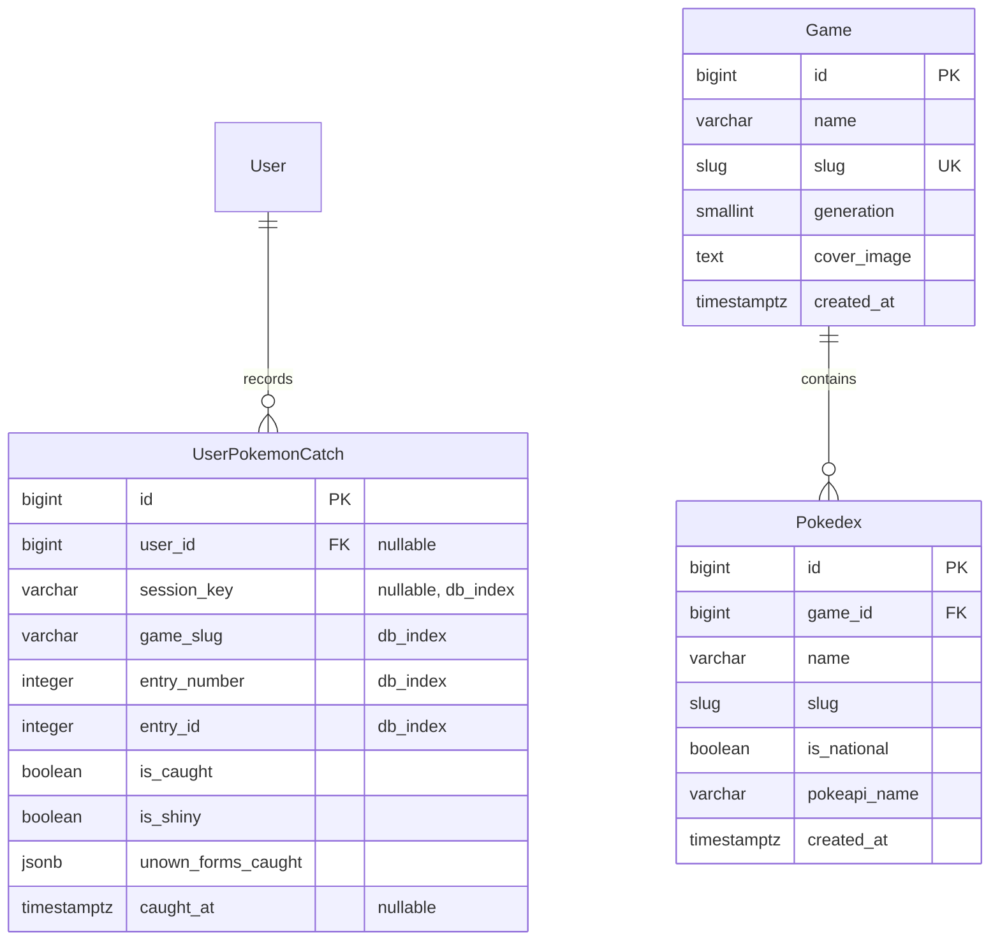

# 🗄️ Database Models & Catalog Schemas (English)

## 1. Active Persistence Entity-Relationship Diagram

In the current **Pokédex Global Tracker** architecture, the relational PostgreSQL database exclusively persists game structural entities and user catch progress:



---

## 2. ORM Model Specifications

### 2.1 `Game` (Video Game Edition)
Represents an official Pokémon franchise title (e.g. *Pokémon Red*, *Pokémon Crystal*, *Pokémon Emerald*).

- **Table:** `tracker_game`
- **Fields:**
  - `id`: Autoincrementing primary key (`BigAuto`).
  - `name`: English/official title (e.g. `"Pokémon Red"`).
  - `slug`: Unique URL slug (e.g. `"red"`, `"crystal"`, `"emerald"`).
  - `generation`: Canonical generation number (1 to 9).
  - `cover_image`: Relative path or URL to game cover art.
  - `created_at`: Record creation timestamp.
- **Dynamic Properties:**
  - `display_name`: Maps canonical name to official Spanish title via `GAME_NAMES_ES` (e.g. `"Pokémon Rojo"`, `"Pokémon Cristal"`).
  - `color_gradient` / `accent_color`: Color palette definitions for the comic UI theme.

### 2.2 `Pokedex` (Pokédex Section)
Defines a catalog section associated with an edition (Regional or National Pokédex).

- **Table:** `tracker_pokedex`
- **Fields:**
  - `id`: Autoincrementing primary key (`BigAuto`).
  - `game`: Foreign key to `Game` (`CASCADE`, `related_name="pokedexes"`).
  - `name`: Descriptive name (e.g. `"Johto Regional Pokédex"`).
  - `slug`: Section slug (e.g. `"johto"`, `"kanto"`, `"national"`).
  - `is_national`: Boolean indicating whether this represents the full National Dex.
  - `pokeapi_name`: Technical identifier from PokeAPI v2 (for asset sync).
  - `created_at`: Creation timestamp.

### 2.3 `UserPokemonCatch` (User Catch Progress)
Stores the catch status of an authenticated user or guest session for a specific species in an edition.

- **Table:** `tracker_userpokemoncatch`
- **Fields:**
  - `user`: Optional foreign key to `auth.User` (`null=True, blank=True, on_delete=CASCADE`).
  - `session_key`: Session key for guest/anonymous visitors (`max_length=50, null=True, blank=True`).
  - `game_slug`: Edition slug (`max_length=30, db_index=True`).
  - `entry_number`: Regional entry number in the game (`PositiveIntegerField, db_index=True`).
  - `entry_id`: Entry identifier in the compiled catalog (`PositiveIntegerField, db_index=True`).
  - `is_caught`: Boolean flag for standard catch status.
  - `is_shiny`: Boolean flag for shiny variant catch status.
  - `unown_forms_caught`: `JSONField` storing individual captured Unown forms (e.g. `{"normal": ["A", "B"], "shiny": ["A"]}`).
  - `caught_at`: Timestamp when the normal catch was marked.
- **Integrity Constraints:**
  - `unique_user_game_entry`: Ensures unique `(user, game_slug, entry_number)` records when `user` is present.
  - `unique_session_game_entry`: Ensures unique `(session_key, game_slug, entry_number)` records for anonymous sessions.
- **High-Performance Indices:**
  - `[user, game_slug]`
  - `[session_key, game_slug]`
  - `[game_slug, entry_id]`
  - `[game_slug, entry_number]`

---

## 3. In-Memory Precompiled Catalogs Schema (0 ms SQL)

All species information, descriptions, base stats, encounter zones, and moves are maintained as static JSON files under `tracker/data/catalogs/<game_slug>.json`.

### Structure of a Catalog Entry (`CatalogEntry`)

```json
{
  "id": 1,
  "entry_number": 1,
  "game_slug": "red",
  "pokemon": {
    "national_number": 1,
    "name": "bulbasaur",
    "display_name": "Bulbasaur",
    "category": "Semilla",
    "height": 7,
    "weight": 69,
    "sprite_url": "/media/pokemon/sprites/red/1.png",
    "sprite_shiny_url": "/media/pokemon/sprites/red_shiny/1.png",
    "artwork_url": "/media/pokemon/artwork/1.png",
    "artwork_shiny_url": "/media/pokemon/artwork/shiny/1.png",
    "primary_type": "grass",
    "secondary_type": "poison"
  },
  "primary_type": "grass",
  "primary_type_display": "Grass",
  "primary_type_es": "Planta",
  "secondary_type": "poison",
  "secondary_type_display": "Poison",
  "secondary_type_es": "Veneno",
  "game_sprite_url": "/media/pokemon/sprites/red/1.png",
  "game_sprite_shiny_url": "/media/pokemon/sprites/red_shiny/1.png",
  "modal_retro_sprite_url": "/media/pokemon/sprites/red/1.png",
  "pc_icon_url": "/media/pokemon/icons/gen1/1.png",
  "cry_url": "/media/pokemon/cries/legacy/1.ogg",
  "flavor_text": "Una rara semilla fue plantada en su lomo al nacer. La planta florece según crece.",
  "obtaining_info": {
    "locations": [
      {
        "area": "Pueblo Paleta",
        "method": "Inicial entregado por el Profesor Oak",
        "condition": "Nivel 5"
      }
    ],
    "evolution": {
      "evolves_to": "Ivysaur",
      "level": 16
    }
  },
  "game_data": {
    "stats": {
      "hp": 45,
      "attack": 49,
      "defense": 49,
      "special": 65,
      "speed": 45
    }
  }
}
```

---

## 4. Backwards-Compatibility Shims in `tracker/models.py`

In `tracker/models.py`, lightweight non-model classes (`MockCatalogManager`, `Pokemon`, `PokedexEntry`, `Move`) exist strictly to:
* Provide interface compatibility with older test fixtures without registering physical PostgreSQL tables.
* Active queries for catalog items should always be dispatched through `tracker.catalog_service` (`get_compiled_catalog`, `get_catalog_entry_by_id`).
