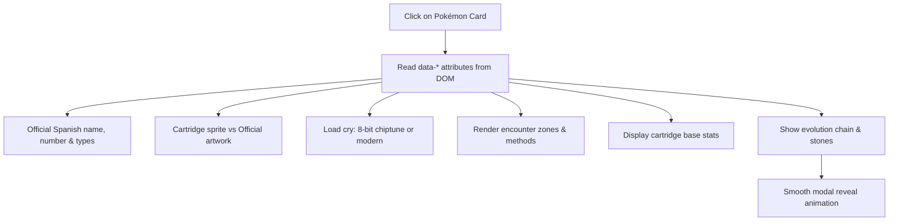

# 🎨 Comic-Book UI Design & Interactive Components (English)

## 1. Visual Aesthetics and Design Philosophy

The interface of **Pokédex Global Tracker** pays homage to classic comic books and vintage manga, combining retro aesthetics with highly responsive modern web components.

### Distinctive Design Elements:
* **Solid Ink Shadows**: Hard drop shadows without blur (`box-shadow: 6px 6px 0px #0f172a;`), simulating letterpress and offset printing.
* **Ben-Day Dot Patterns**: Vintage geometric background textures (`.comic-dots`).
* **Comic Speech Bubbles**: Dynamic dialogue balloons with directional pointers rendering official Pokédex entries.
* **Heavy Panel Borders**: Bold comic frames (`border-3 border-slate-900`) defining cards and sections.
* **Crisp Pixel Art**: Explicit `image-rendering: pixelated;` for retro sprites, maintaining sharp lines on high-DPI displays.
* **Edition-Adaptive Palettes**: Dynamic color themes matching the active title (Red, Blue, Yellow, Gold, Silver, Crystal, Ruby, Sapphire, Emerald, FireRed, LeafGreen, Diamond, etc.).

---

## 2. The Game Hub (`/games/`)

The **Game Hub** serves as the central command center for trainers:
* **Generational Tabs**: Rapid filtering across canonical eras (Kanto Gen 1, Johto Gen 2, Hoenn Gen 3, Sinnoh Gen 4, etc.).
* **Dual Progress Bars**: Each edition card features two retro progress meters:
  1. **Regional Progress**: Percentage of species caught in the game's native Pokédex.
  2. **National Progress**: Completion percentage of the National Dex for compatible titles.
* **Total Catch Counters**: Consolidated generation metrics and account-wide statistics.

---

## 3. Illustrated Detail Modal

Clicking any card in the grid opens an interactive comic-panel modal without page reloads:

### 3.1 Dual Audio Engine & Cries
* **Retro Generations (Gen 1 to 5)**: Emits vintage 8-bit chiptune cries sourced directly from classic hardware audio chips.
* **Modern Generations (Gen 6+)**: Emits modern, high-fidelity orchestrated cries.
* **Interactive Soundwave Button**: Triggers cry audio playback on demand.

### 3.2 Canonical Encounter Methods
* Locations follow official Spanish toponymy (e.g. *«Ruta 201»*, *«Monte Corona»*, *«Cueva Cardumen»*).
* Detailed acquisition methods: Tall grass, Surfing, Fishing rods, Headbutt, Rock Smash, Trades, and Gifts.

---

## 4. Special Tracking Modes

### 4.1 Shiny Mode with Celestial Visuals
* A dedicated navbar toggle enables switching between **Normal Mode** and **Shiny Mode**.
* When Shiny Mode is active:
  - Cards gain golden star borders and celestial accent icons.
  - Sprites display canonical shiny color palettes.
  - Progress counters isolate and track shiny completion separately.

### 4.2 Dedicated Unown Glyph Modal
* In editions featuring ruins, the Unown card links directly to the **Ruins Album**.
* Displays an interactive grid of all 26 alphabetical forms (A-Z) and punctuation marks (? and !).
* Allows independent tracking of normal and shiny variants per glyph.

---

## 5. Real-Time Client-Side Filtering

The main grid features instant, multi-faceted filtering:
1. **Universal Search**: Filters live by regional number (`025`), national number, Spanish name (`Bulbasur`), or English name (`Bulbasaur`).
2. **Elemental Type Filter**: Dropdown with historical type badges respecting edition mechanics.
3. **Fishing Rod Filter**: Isolates species catchable with Old Rod, Good Rod, or Super Rod.
4. **Special Category Tags**: Quick-access pills for Starters, Fossils, Legendaries/Mythicals, Babies, and Version Exclusives.
5. **Catch State Filter**: Instant toggle between "All", "Caught", and "Pending".
