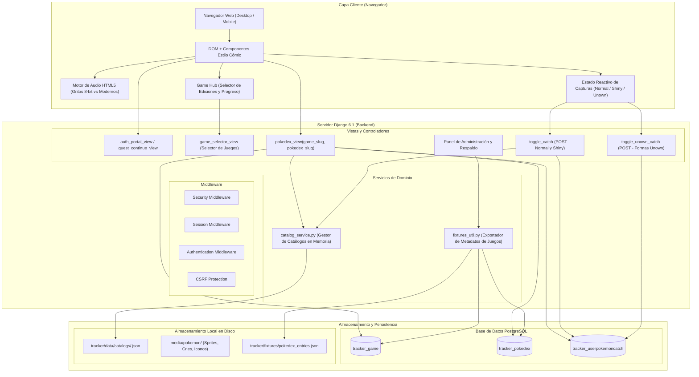
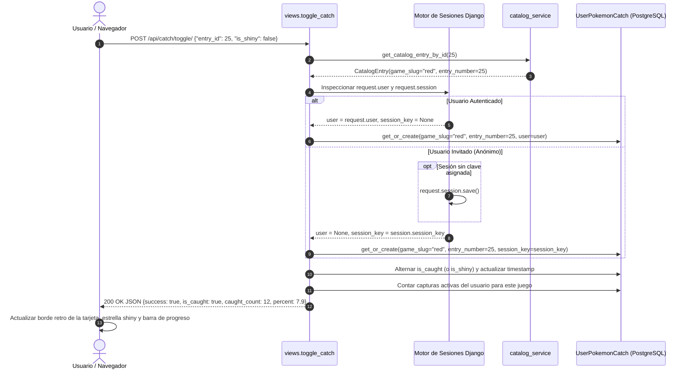

# 🏛️ Arquitectura y Diseño del Sistema (Español)

## 1. Visión General del Sistema

**Pokédex Global Tracker** está diseñado como una plataforma web Django de alto rendimiento orientada a la preservación histórica y seguimiento de capturas en todas las generaciones de la franquicia Pokémon.

La arquitectura del sistema se fundamenta en un desacoplamiento estratégico entre **datos canónicos estáticos** y **estado dinámico de usuario**:
1. **Catálogos Inmutables en Memoria (0 ms SQL)**: Las especies, números regionales, estadísticas, tipos históricos, encuentros oficiales en castellano y sprites no se consultan contra tablas pesadas de base de datos en cada petición, sino que se sirven desde catálogos compilados en JSON cargados en memoria por `catalog_service.py`.
2. **Persistencia Relacional Ligera**: PostgreSQL almacena de forma exclusiva las entidades estructurales de juego (`Game`, `Pokedex`) y el progreso transaccional de captura de los usuarios (`UserPokemonCatch`), admitiendo tanto sesiones de invitados como cuentas registradas.
3. **Experiencia de Usuario Retro-Interactiva**: Interfaz inspirada en historietas clásicas (trama Ben-Day, sombras de tinta sólida), reproductor dinámico de gritos chiptune/orquestados, selector integral de juegos (Game Hub), seguimiento de variantes variocolor (shiny) y glifos Unown.

---

## 2. Diagrama de Arquitectura del Sistema

---

## 3. Evolución del Sistema: Arquitectura de Catálogos Precompilados en Memoria (0 ms SQL)

> [!NOTE]
> **Decisión de Diseño:** En versiones iniciales del proyecto, las especies y entradas de la Pokédex se persistían en tablas relacionales ORM (`Pokemon`, `PokedexEntry`, `Move`). Este diseño generaba miles de registros estáticos en base de datos, consultas $N+1$ complejas para armar la cuadrícula y dependencia constante de migraciones SQL al incorporar nuevos títulos.

Para superar este cuello de botella y garantizar una experiencia *Offline-First* con latencia cero:
1. **Catálogos Compilados Inmutables**: Todos los datos canónicos de cada juego se precompilan en archivos JSON estructurados bajo `tracker/data/catalogs/<game_slug>.json`.
2. **Carga en Memoria `CatalogService`**: Al arrancar la vista o recibir peticiones, `tracker.catalog_service` deserializa el catálogo del juego solicitado y lo conserva en caché en memoria (`_CATALOG_CACHE`), comprobando el `mtime` del archivo para recargas instantáneas en caliente.
3. **Persistencia Relacional Exclusiva para Capturas**: PostgreSQL optimiza su asignación de recursos al no mantener tablas estáticas de catálogo, enfocando su motor de persistencia en la indexación eficiente de las capturas de usuario (`UserPokemonCatch`).

---

## 4. Ciclo de Vida del Seguimiento de Capturas

### 4.1 Identidad Dual de Usuario (Invitado vs Registrado)
El sistema permite capturar de inmediato sin registro obligatorio mediante sesiones anónimas de Django, permitiendo migrar o conservar el progreso:

### 4.2 Modalidad Dual de Captura (Normal vs Shiny)
* El endpoint `/api/catch/toggle/` acepta el flag booleano `is_shiny`.
* La base de datos almacena independientemente `is_caught` e `is_shiny` en la misma fila `UserPokemonCatch` identificada por `(game_slug, entry_number)`.
* Esto permite alternar la vista entre el modo normal y el modo variocolor sin recargar la página, conservando estadísticas separadas de completitud.

### 4.3 Tracking Específico de Glifos Unown
* Para títulos con ruinas y alfabetos Unown (ej. Gen 2 Oro/Plata/Cristal y Gen 3 Rojo Fuego/Verde Hoja), el endpoint `/api/unown-catch/toggle/` interactúa con el campo nativo `JSONField(unown_forms_caught)`.
* Estructura del payload: `{"normal": ["A", "F", "R"], "shiny": ["A"]}`.
* Al capturar al menos una forma, la tarjeta de Unown se computa como capturada en la Pokédex general, permitiendo además inspeccionar el progreso individual de las 26 a 28 letras en su modal dedicado.

---

## 5. Optimizaciones de Rendimiento

1. **Lectura $O(1)$ de Catálogos**: Acceso directo en memoria sin transacciones ni bloqueos de base de datos.
2. **Carga en Conjunto (`set`) de Capturas**: En `pokedex_view`, todas las capturas del usuario activo para el juego se recuperan en una sola consulta indexada (`values_list('entry_number', flat=True)`) y se evalúan en memoria en tiempo constante $O(1)$.
3. **Índices Compuestos de Base de Datos**:
   * `[user, game_slug]`
   * `[session_key, game_slug]`
   * `[game_slug, entry_number]`
4. **Invalidación Reactiva de Caché de Juegos**: Señales Django `post_save` y `post_delete` en `Game` invalidan la clave `all_games_catalog` en la caché para sincronización inmediata tras ediciones administrativas.
