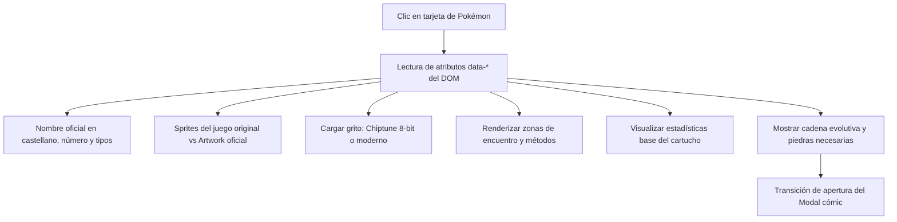

# 🎨 Diseño de Interfaz Estilo Cómic y Componentes Interactivos (Español)

## 1. Filosofía de Diseño y Estética Visual

El diseño visual de **Pokédex Global Tracker** rinde homenaje a las historietas y mangas clásicos combinando técnicas retro con componentes web modernos y de alta reactividad.

### Elementos Gráficos Distintivos:
* **Sombras de Tinta Sólida**: Sombras CSS puras con desplazamiento rígido sin desenfoque (`box-shadow: 6px 6px 0px #0f172a;`), evocando el grabado en planchas de imprenta.
* **Trama de Puntos Ben-Day**: Fondos con micropatrones geométricos inspirados en el fotograbado analógico (`.comic-dots`).
* **Bocadillos de Diálogo**: Globos de conversación de historieta con colas dinámicas para renderizar las entradas oficiales de la Pokédex.
* **Bordes Gruesos y Marcados**: Delimitación de paneles (`border-3 border-slate-900`) simulando las viñetas de una página de cómic.
* **Renderizado Pixelado Nítido**: Activación de `image-rendering: pixelated;` en sprites clásicos para garantizar fidelidad total en pantallas 4K y Retina.
* **Paletas Adaptativas por Edición**: Temas de acento cromático contextuales según la versión activa (Rojo, Azul, Amarillo, Oro, Plata, Cristal, Rubí, Zafiro, Esmeralda, Rojo Fuego, Verde Hoja, Diamante, etc.).

---

## 2. El Game Hub (`/games/`)

El **Game Hub** es el centro de control del entrenador:
* **Organización Generacional**: Pestañas de filtrado rápido por era canónica (Kanto Gen 1, Johto Gen 2, Hoenn Gen 3, Sinnoh Gen 4, etc.).
* **Barras de Progreso Dual**: Cada tarjeta de edición presenta dos barras de progreso retro:
  1. **Progreso Regional**: Porcentaje de especies capturadas de la Pokédex propia del cartucho.
  2. **Progreso Nacional**: Completitud de la Pokédex Nacional para las entregas que incorporan este modo.
* **Contador Total de Capturas**: Métricas consolidadas por generación y estadísticas globales de la cuenta.

---

## 3. Modal Ilustrado de Detalle del Pokémon

Al hacer clic sobre cualquier tarjeta de la cuadrícula, se despliega una ventana modal interactiva sin recarga de página:

### 3.1 Motor de Audio y Gritos de Combate
* **Generaciones Retro (Gen 1 a 5)**: Reproduce los gritos originales chiptune en 8 bits digitalizados de los cartuchos clásicos.
* **Generaciones Modernas (Gen 6 en adelante)**: Emite los gritos actualizados y orquestados de la era 3D.
* **Control Interactivo**: Botón de onda sonora retro que permite reproducir el sonido tantas veces como el usuario desee.

### 3.2 Desglose Exhaustivo de Encuentros y Métodos
* Las descripciones de área siguen la toponimia oficial en castellano (ej. *«Ruta 201»*, *«Monte Corona»*, *«Cueva Cardumen»*).
* Indica los métodos exactos de obtención: Hierba alta, Surf, Cañas de pescar, Golpe de cabeza, Rocas con Golpe Roca, Eventos o Regalos.

---

## 4. Modalidades Especiales de Seguimiento

### 4.1 Modo Variocolor (Shiny) con Estética Estelar
* La barra de herramientas incluye un interruptor dedicado para conmutar entre **Modo Normal** y **Modo Shiny**.
* Al activar el modo shiny:
  - Las tarjetas adoptan bordes dorados con efectos estelares.
  - Los sprites cambian a su paleta variocolor oficial de la edición.
  - El marcador de progreso contabiliza de forma aislada las capturas shiny.

### 4.2 Modal Dedicado para Glifos Unown
* En las ediciones con ruinas (Gen 2 y remakes de Gen 3), la tarjeta de Unown incluye un botón de acceso al **Álbum de las Ruinas**.
* Abre una cuadrícula con las 26 formas alfabéticas (A-Z) y los signos de interrogación y exclamación (! y ?).
* Cada glifo permite marcar su captura individual tanto en variante normal como en shiny.

---

## 5. Filtros y Búsqueda Reactiva en Tiempo Real

La cuadrícula de la Pokédex incluye controles combinables en el cliente sin latencia de red:
1. **Buscador Universal**: Filtra instantáneamente por número regional (ej. `025`), número nacional, nombre en español (ej. `Bulbasur`) o nombre en inglés (`Bulbasaur`).
2. **Selector de Tipos Elementales**: Desplegable con insignias de tipo (Fuego, Agua, Planta, Dragón, etc.) que respeta los tipos históricos canónicos de la edición.
3. **Filtro de Cañas de Pescar**: Permite aislar exclusivamente las especies capturables con Caña Vieja, Caña Buena o Súper Caña.
4. **Filtros Canónicos Especiales**: Botones de acceso rápido para Iniciales, Fósiles, Legendarios/Singulares, Bebés y Exclusivos de versión.
5. **Estado de Captura**: Conmutador rápido entre "Todos", "Solo Capturados" y "Solo Pendientes".
