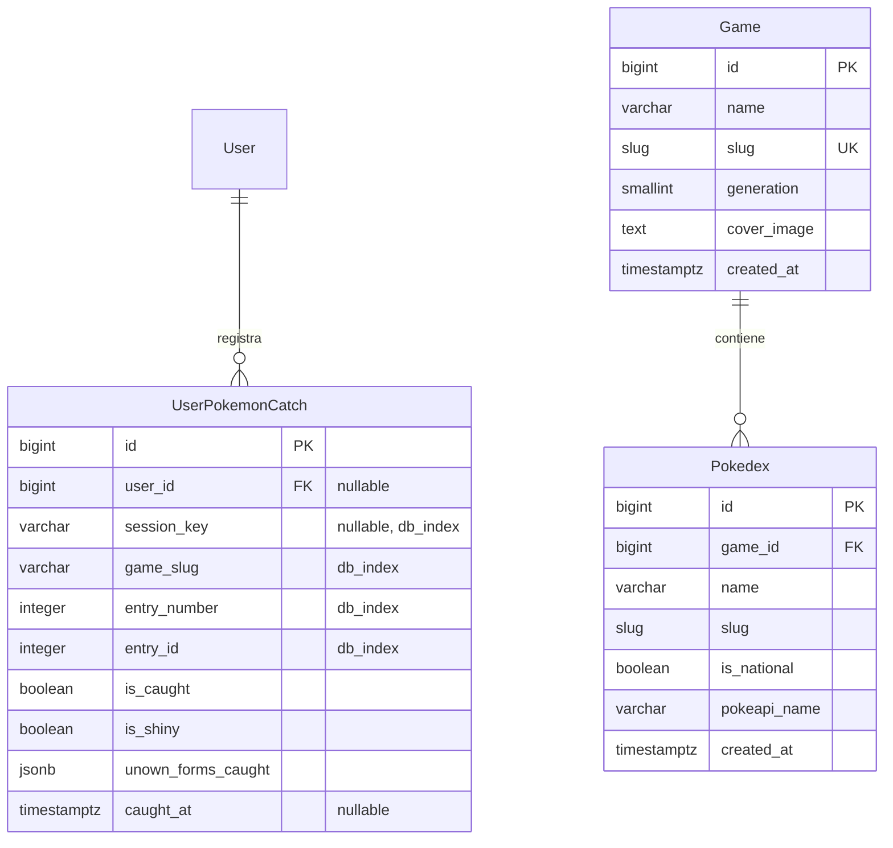

# 🗄️ Modelos de Base de Datos y Esquemas de Catálogo (Español)

## 1. Diagrama Entidad-Relación de Persistencia Activa

En la arquitectura actual de **Pokédex Global Tracker**, la base de datos relacional PostgreSQL persiste de forma exclusiva las entidades estructurales de juego y el progreso de capturas de los usuarios:



---

## 2. Especificación Detallada de Modelos ORM

### 2.1 `Game` (Juego o Edición)
Representa un título oficial de la franquicia (ej. *Pokémon Rojo*, *Pokémon Cristal*, *Pokémon Esmeralda*).

- **Tabla:** `tracker_game`
- **Campos:**
  - `id`: Clave primaria autoincremental (`BigAuto`).
  - `name`: Nombre oficial del juego (ej: `"Pokémon Red"`).
  - `slug`: Slug identificador único para URLs (ej: `"red"`, `"crystal"`, `"emerald"`).
  - `generation`: Número de generación canónica (1 a 9).
  - `cover_image`: Ruta relativa o URL a la carátula oficial.
  - `created_at`: Fecha y hora de creación del registro.
- **Propiedades Dinámicas:**
  - `display_name`: Traduce el nombre canónico al español oficial mediante el mapeo interno `GAME_NAMES_ES` (ej. `"Pokémon Rojo"`, `"Pokémon Cristal"`).
  - `color_gradient` / `accent_color`: Devuelve las clases y valores cromáticos del tema visual de la edición para la interfaz cómic.

### 2.2 `Pokedex` (Índice de Pokédex)
Define un listado o sección de catálogo asociado a un juego (Pokédex Regional o Pokédex Nacional).

- **Tabla:** `tracker_pokedex`
- **Campos:**
  - `id`: Clave primaria autoincremental (`BigAuto`).
  - `game`: Clave foránea hacia `Game` (`CASCADE`, `related_name="pokedexes"`).
  - `name`: Nombre descriptivo (ej: `"Pokédex Regional de Johto"`).
  - `slug`: Slug de la sección (ej: `"johto"`, `"kanto"`, `"national"`).
  - `is_national`: Booleano que indica si representa el listado nacional completo.
  - `pokeapi_name`: Identificador técnico original de PokeAPI v2 (para sincronización).
  - `created_at`: Marca temporal de creación.

### 2.3 `UserPokemonCatch` (Registro Transaccional de Captura)
Registra el progreso de captura de un usuario registrado o una sesión de invitado para una especie en un juego específico.

- **Tabla:** `tracker_userpokemoncatch`
- **Campos:**
  - `user`: Clave foránea opcional a `auth.User` (`null=True, blank=True, on_delete=CASCADE`).
  - `session_key`: Identificador de sesión para usuarios anónimos/invitados (`max_length=50, null=True, blank=True`).
  - `game_slug`: Slug de la edición de juego (`max_length=30, db_index=True`).
  - `entry_number`: Número regional de la especie en el juego (`PositiveIntegerField, db_index=True`).
  - `entry_id`: Identificador único de la entrada en el catálogo compilado (`PositiveIntegerField, db_index=True`).
  - `is_caught`: Booleano que indica si la especie fue capturada en modo normal.
  - `is_shiny`: Booleano que indica si la variante variocolor (shiny) fue capturada.
  - `unown_forms_caught`: `JSONField` que registra las formas individuales capturadas de Unown (ej. `{"normal": ["A", "B"], "shiny": ["A"]}`).
  - `caught_at`: Fecha y hora en la que se registró la captura normal.
- **Restricciones de Integridad (`constraints`):**
  - `unique_user_game_entry`: Impide duplicados de `(user, game_slug, entry_number)` cuando `user` no es nulo.
  - `unique_session_game_entry`: Impide duplicados de `(session_key, game_slug, entry_number)` para sesiones anónimas.
- **Índices de Alto Rendimiento:**
  - `[user, game_slug]`
  - `[session_key, game_slug]`
  - `[game_slug, entry_id]`
  - `[game_slug, entry_number]`

---

## 3. Esquema de los Catálogos Precompilados en Memoria (0 ms SQL)

Toda la información estática de especies, descripciones, estadísticas y zonas de encuentro se gestiona mediante archivos JSON estáticos inmutables en `tracker/data/catalogs/<game_slug>.json`.

### Estructura de cada Objeto del Catálogo (`CatalogEntry`)

```json
{
  "id": 1,
  "entry_number": 1,
  "game_slug": "red",
  "pokemon": {
    "national_number": 1,
    "name": "bulbasaur",
    "display_name": "Bulbasaur",
    "category": "Semilla",
    "height": 7,
    "weight": 69,
    "sprite_url": "/media/pokemon/sprites/red/1.png",
    "sprite_shiny_url": "/media/pokemon/sprites/red_shiny/1.png",
    "artwork_url": "/media/pokemon/artwork/1.png",
    "artwork_shiny_url": "/media/pokemon/artwork/shiny/1.png",
    "primary_type": "grass",
    "secondary_type": "poison"
  },
  "primary_type": "grass",
  "primary_type_display": "Grass",
  "primary_type_es": "Planta",
  "secondary_type": "poison",
  "secondary_type_display": "Poison",
  "secondary_type_es": "Veneno",
  "game_sprite_url": "/media/pokemon/sprites/red/1.png",
  "game_sprite_shiny_url": "/media/pokemon/sprites/red_shiny/1.png",
  "modal_retro_sprite_url": "/media/pokemon/sprites/red/1.png",
  "pc_icon_url": "/media/pokemon/icons/gen1/1.png",
  "cry_url": "/media/pokemon/cries/legacy/1.ogg",
  "flavor_text": "Una rara semilla fue plantada en su lomo al nacer. La planta florece según crece.",
  "obtaining_info": {
    "locations": [
      {
        "area": "Pueblo Paleta",
        "method": "Inicial entregado por el Profesor Oak",
        "condition": "Nivel 5"
      }
    ],
    "evolution": {
      "evolves_to": "Ivysaur",
      "level": 16
    }
  },
  "game_data": {
    "stats": {
      "hp": 45,
      "attack": 49,
      "defense": 49,
      "special": 65,
      "speed": 45
    }
  }
}
```

---

## 4. Shims de Retrocompatibilidad en `tracker/models.py`

En `tracker/models.py` se definen clases ligeras no-modelo (`MockCatalogManager`, `Pokemon`, `PokedexEntry`, `Move`):
* **Propósito:** Mantener compatibilidad de interfaz con firmas de código legacy y tests antiguos sin crear tablas físicas en PostgreSQL ni alterar el esquema relacional.
* **Comportamiento:** Su manager simulado no persiste en base de datos; cualquier consulta directa de lectura debe realizarse a través de `tracker.catalog_service` (`get_compiled_catalog`, `get_catalog_entry_by_id`).
